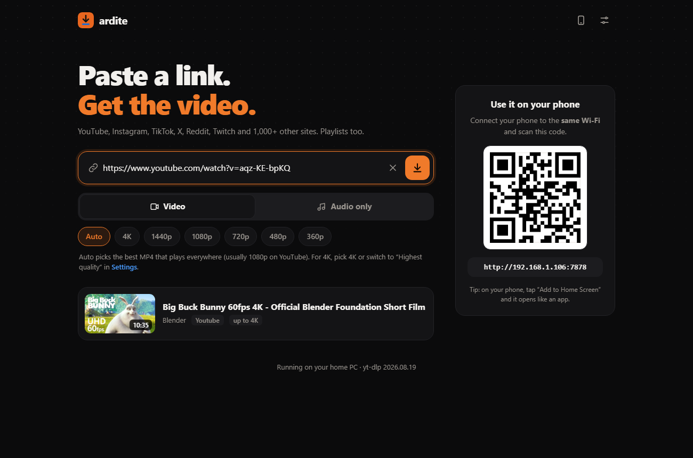
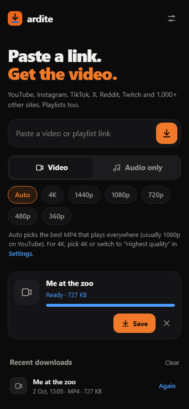
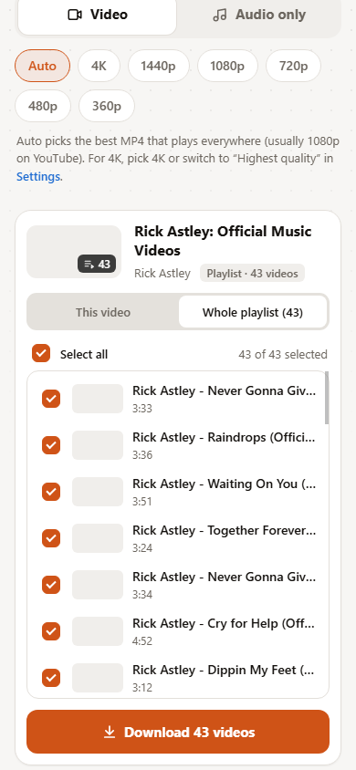

<p align="center">
  
</p>

<h1 align="center">Ardite</h1>

<p align="center">
  A self-hosted video downloader for your computer (Windows, Linux or macOS).<br>
  Open it from any device on the same Wi-Fi, paste a link and the file downloads to that device.
</p>

<p align="center">
  <a href="https://github.com/vuxenn1/ardite/releases/latest"></a>
  <a href="LICENSE"></a>
</p>

<p align="center">
  
</p>

<p align="center">
  
  &nbsp;&nbsp;
  
</p>

## Features

- **1000+ sites**: YouTube, Instagram, TikTok, X, Reddit, Twitch and [many more](https://github.com/yt-dlp/yt-dlp/blob/master/supportedsites.md)
- **Best quality**: up to 4K/8K and 60 fps, never re-encoded. Each download shows what it really got (e.g. "4K60 · VP9") and warns you if the site handed out a lower quality than usual.
- **Audio only**: MP3, M4A, OPUS, WAV or the original format, with cover art
- **Trim**: drag a slider to download only part of a video
- **GIF**: pick a few seconds and get them as a GIF in three sizes
- **Subtitles**: pick languages, get them embedded in the video (switch them on or off in your player) or as separate `.srt` files
- **Playlists**: choose the videos you want and get them as a ZIP
- **Any device**: scan the QR code on the computer to open Ardite on your phone. Files are saved on whichever device you use.
- **Shared history**: see what was downloaded on every device and by which one (give each device a name in Settings); titles and links only, never the files
- **Statistics**: downloads and gigabytes per month, by day and hour, by site, device, quality and format, with a CSV export. Only numbers are kept for them, no titles or links
- **PIN lock**: optionally keep others on your Wi-Fi out
- **Works like an app**: install it on the phone's home screen; on Android, share a link from YouTube or any other app straight to Ardite
- **HTTPS**: an encrypted address for phones, with Ardite's own certificate (set up once per phone, nothing to buy or sign up for)
- **English and Turkish**, light and dark theme

## Installation

### Windows

Requires Windows 10/11. Nothing else to install.

1. Download **[Ardite-win64.zip](https://github.com/vuxenn1/ardite/releases/latest/download/Ardite-win64.zip)** from the [latest release](https://github.com/vuxenn1/ardite/releases/latest).
2. Extract it somewhere permanent (for example your Documents folder).
3. Double-click `install.bat` and click **Yes** when Windows asks for firewall permission.

This downloads yt-dlp and ffmpeg (each checked against its published SHA-256 hash), makes Ardite start in the background with Windows and opens the firewall for your home network. Ardite keeps yt-dlp up to date by itself (Settings can switch it to daily nightly builds) and updates ffmpeg about once a month.

### Linux and macOS

Nothing else to install either. In a terminal, in the folder where Ardite should live:

```sh
curl -fsSL https://github.com/vuxenn1/ardite/releases/latest/download/Ardite-linux-x64.tar.gz | tar -xz
cd Ardite && ./ardite install
```

Use the package for your computer instead of `Ardite-linux-x64` when needed: `Ardite-linux-arm64` (Raspberry Pi and other ARM boards), `Ardite-macos-arm64` (Apple silicon) or `Ardite-macos-x64` (Intel Macs).

This downloads yt-dlp and ffmpeg for your system, starts Ardite and makes it start at login (a systemd user service on Linux, a LaunchAgent on macOS). On macOS, also install ffmpeg with [Homebrew](https://brew.sh) (`brew install ffmpeg`), since there's no verified build to download for it. If phones can't connect on Linux, the command tells you how to open the port in your firewall.

### Docker

For a server or a NAS (x64 and ARM):

```sh
docker run -d --name ardite --init --network host --restart unless-stopped \
  -v ardite-data:/app/data ghcr.io/vuxenn1/ardite
```

yt-dlp and ffmpeg come in the image, and yt-dlp keeps itself up to date. Settings, history and statistics stay in the `ardite-data` volume. `--network host` lets Ardite see the server's own address for the QR code; without it, publish the port with `-p 7878:7878` instead. Add `-e TZ=Europe/Istanbul` (your time zone) for local times in the log. To update, pull the new image and start the container again.

### Updating

Ardite tells you when a new version is out. Press **Update now**: it downloads the new version, checks it, restarts and the page refreshes by itself. Your settings, history and tools are kept. If the new version doesn't start, the previous one is put back automatically (details in `data/update/update.log`). `ardite update` does the same from the command line.

Updating by hand works too: run `ardite stop` (`stop.bat`), extract the new package over the old folder and run `ardite install` (`install.bat`) again.

## Usage

- On the computer: open **http://localhost:7878**
- On a phone (same Wi-Fi): scan the QR code shown on the computer
- As an app: set up the secure connection (below), then use **Settings > Use it like an app** (or **Add to Home Screen** in Safari). On Android, Ardite then appears when you share a link from another app.

Paste a link. The video shows up in a card with all its options: video or audio, quality, trim and subtitles. The download button sums up what you'll get.

Ardite is managed with the `ardite` command in its folder (`ardite.cmd` on Windows, `./ardite` on Linux and macOS). On Windows the `.bat` files do the same with a double-click.

| Command | What it does |
|---|---|
| `ardite install` | Download the tools, start Ardite now and at every login, open it (`install.bat`) |
| `ardite start` / `stop` / `restart` | Start or stop Ardite (`start.bat`, `stop.bat`) |
| `ardite status` | Show whether it runs and the addresses for a phone (`status.bat`) |
| `ardite update` | Install the newest version |
| `ardite autostart on` / `off` | Start Ardite when you log in, or not |
| `ardite firewall on` / `off` | Let phones through the Windows firewall, or not |
| `ardite uninstall` | Stop Ardite, remove autostart and the firewall rule (`uninstall.bat`) |

### PIN lock

By default anyone on your Wi-Fi can open Ardite. To keep others out, set a PIN in **Settings > PIN lock**. Each phone or other device asks for it once and then remembers it; changing the PIN signs them all out. The computer Ardite runs on never asks, so a forgotten PIN can simply be changed there.

### Secure connection (HTTPS)

Ardite answers on `https://` too, on the same port. Browsers only trust it once the device has Ardite's certificate, which takes a minute per phone: open **Settings > Secure connection** on the computer, scan the code with the phone and follow the steps it shows for Android, iPhone or a computer. When the page says **Done**, open the secure address.

The certificate is made on your computer the first time Ardite starts (in `data/tls`) and only works for Ardite on your home network (private addresses, `localhost` and `*.local` names). It can't be used to impersonate any other website. Set `"https": false` in the settings file to turn HTTPS off.

### Videos that need a login

Some videos (age-restricted or private) require you to be signed in, and YouTube sometimes asks to confirm you're not a bot after many downloads. Add your login in **Settings > Videos that need a login**:

- **Any browser**: install the [Get cookies.txt LOCALLY](https://github.com/kairi003/Get-cookies.txt-LOCALLY) extension, open youtube.com while signed in, export the cookies and press **Upload cookies.txt**. The file holds your login, so keep it private.
- **Firefox**: when Firefox is installed, you can simply turn on **Use my Firefox login**.

Chrome and Edge can't be read directly: on Windows they encrypt their logins in a way yt-dlp can't open, so use the extension for them. The **Test** button checks that the login can be read.

### Settings file

Optional settings go in `data/config.json`, for example:

```json
{
  "port": 7878,
  "maxConcurrent": 2,
  "keepFilesMinutes": 30,
  "maxPlaylistItems": 500,
  "cookiesFromBrowser": "firefox",
  "updateCheck": true
}
```

| Setting | Meaning |
|---|---|
| `port` | Address port (`http://localhost:<port>`) |
| `maxConcurrent` | Downloads running at the same time. Single videos go before playlist items, and one may always start even while a playlist fills every slot |
| `keepFilesMinutes` | How long finished files wait on the computer to be saved |
| `maxPlaylistItems` | Most videos shown for a playlist |
| `cookiesFromBrowser` | Use a browser's login (`firefox`); set from Settings. Chrome and Edge don't work on Windows |
| `updateCheck` | Look for new Ardite versions on GitHub |
| `https` | `false` turns off the `https://` address (on by default, see Secure connection) |
| `ytdlpChannel` | `nightly` for a new yt-dlp every day (fixes for changed sites arrive first); set from Settings. Regular releases (`stable`) by default |
| `tempFolder` | Where downloads wait on the computer until they're saved, e.g. `"D:\\Ardite"` (the system's temp folder by default) |
| `minFreeGB` | Free space a download needs to start (default 2). A running download stops before the disk drops below half of it |
| `allowedHosts` | Extra names Ardite may be opened with, e.g. `["mypc.tail1234.ts.net"]`. IP addresses, `localhost` and the computer's own name always work; other names are refused so websites can't use Ardite |

<details>
<summary>Running from source</summary>

Requires [Node.js](https://nodejs.org) 20.15 or newer. Download this repository (**Code > Download ZIP**), extract it and run `ardite install` (on Windows `install.bat`). Updates then come with `git pull` or a new download.

Run the tests with `node --test` (they also run on Windows, Linux and macOS on every push). They need no internet: a stand-in replaces yt-dlp. The web page tests drive a headless Edge or Chrome and are skipped when neither is installed (`ARDITE_BROWSER` can point to one).

To publish a release, push a tag like `v1.5.0`. GitHub Actions builds the packages for Windows, Linux and macOS with Node.js included (`.github/build-packages.sh`) and the Docker image, runs the tests, the setup and a smoke test with each package on its own system, and only then publishes them.

</details>

## Disclaimer

Only download content you own or have permission to download.

## License

[MIT](LICENSE). Built on [yt-dlp](https://github.com/yt-dlp/yt-dlp) and [FFmpeg](https://ffmpeg.org).
