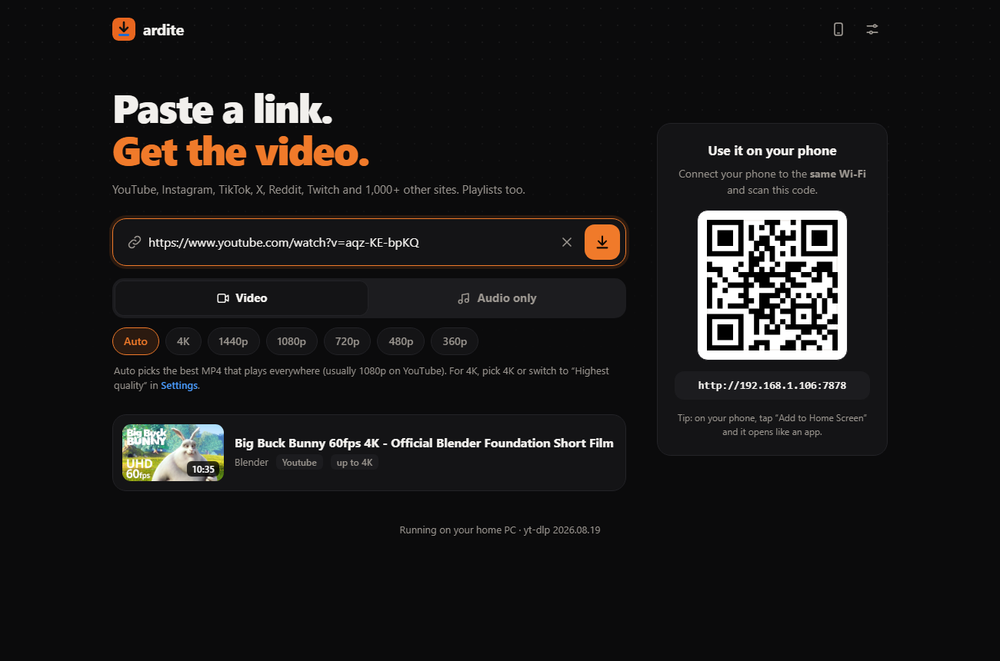
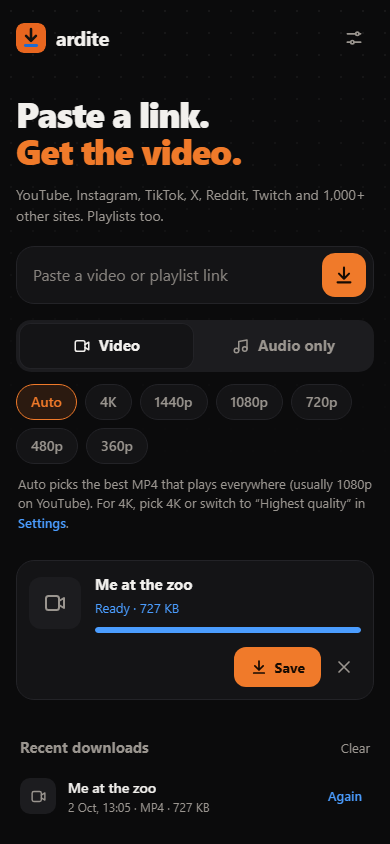
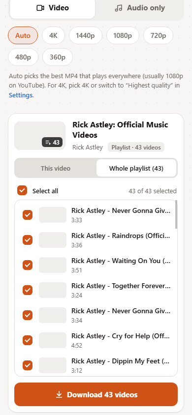

<p align="center">
  
</p>

<h1 align="center">Ardite</h1>

<p align="center">
  A self-hosted video downloader for your Windows PC.<br>
  Open it from any device on the same Wi-Fi, paste a link and the file downloads to that device.
</p>

<p align="center">
  <a href="https://github.com/vuxenn1/ardite/releases/latest"></a>
  <a href="LICENSE"></a>
</p>

<p align="center">
  
</p>

<p align="center">
  
  &nbsp;&nbsp;
  
</p>

## Features

- **1000+ sites**: YouTube, Instagram, TikTok, X, Reddit, Twitch and [many more](https://github.com/yt-dlp/yt-dlp/blob/master/supportedsites.md)
- **Best quality**: up to 4K/8K and 60 fps, never re-encoded. Each download shows what it really got (e.g. "4K60 · VP9") and warns you if the site handed out a lower quality than usual.
- **Audio only**: MP3, M4A, OPUS, WAV or the original format, with cover art
- **Trim**: drag a slider to download only part of a video
- **Subtitles**: pick languages, get them embedded in the video (switch them on or off in your player) or as separate `.srt` files
- **Playlists**: choose the videos you want and get them as a ZIP
- **Any device**: scan the QR code on the PC to open Ardite on your phone. Files are saved on whichever device you use.
- **Shared history**: see what was downloaded on every device (titles and links only, never the files)
- **English and Turkish**, light and dark theme

## Installation

Requires Windows 10/11. Nothing else to install.

1. Download **[Ardite-win64.zip](https://github.com/vuxenn1/ardite/releases/latest/download/Ardite-win64.zip)** from the [latest release](https://github.com/vuxenn1/ardite/releases/latest).
2. Extract it somewhere permanent (for example your Documents folder).
3. Double-click `install.bat` and click **Yes** when Windows asks for firewall permission.

This downloads yt-dlp and ffmpeg, makes Ardite start in the background with Windows and opens the firewall for your home network.

### Updating

Ardite tells you when a new version is out. To update, run `stop.bat`, extract the new release over the old folder and run `install.bat` again. Your settings and history in the `data` folder are kept.

## Usage

- On the PC: open **http://localhost:7878**
- On a phone (same Wi-Fi): scan the QR code shown on the PC

Paste a link. The video shows up in a card with all its options: video or audio, quality, trim and subtitles. The download button sums up what you'll get.

| Script | What it does |
|---|---|
| `start.bat` | Start Ardite |
| `stop.bat` | Stop Ardite |
| `status.bat` | Show status and addresses |
| `uninstall.bat` | Remove autostart and the firewall rule |

### Videos that need a login

Some videos (age-restricted or private) require you to be signed in, and YouTube sometimes asks to confirm you're not a bot after many downloads. Put a `cookies.txt` file (Netscape format, exported with a browser extension) in the `data` folder. Keep it private.

### Settings file

Optional settings go in `data/config.json`, for example:

```json
{
  "port": 7878,
  "maxConcurrent": 2,
  "keepFilesMinutes": 30,
  "maxPlaylistItems": 500,
  "cookiesFromBrowser": "firefox",
  "updateCheck": true
}
```

| Setting | Meaning |
|---|---|
| `port` | Address port (`http://localhost:<port>`) |
| `maxConcurrent` | Downloads running at the same time |
| `keepFilesMinutes` | How long finished files wait on the PC to be saved |
| `maxPlaylistItems` | Most videos shown for a playlist |
| `cookiesFromBrowser` | Use a browser's login instead of `cookies.txt` (`firefox`, `chrome`, `edge`…) |
| `updateCheck` | Look for new Ardite versions on GitHub |

<details>
<summary>Running from source</summary>

Requires [Node.js](https://nodejs.org) 20.15 or newer. Download this repository (**Code > Download ZIP**), extract it and double-click `install.bat`.

Run the tests with `node --test` (they also run on every push).

To publish a release, push a tag like `v1.5.0`. GitHub Actions builds `Ardite-win64.zip` with Node.js included, runs the tests and a smoke test on Windows with the packaged app, and only then attaches it to the release.

</details>

## Disclaimer

Only download content you own or have permission to download.

## License

[MIT](LICENSE). Built on [yt-dlp](https://github.com/yt-dlp/yt-dlp) and [FFmpeg](https://ffmpeg.org).
